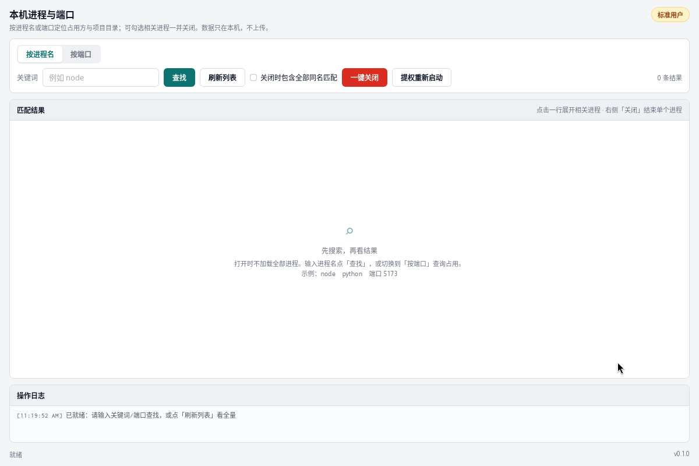
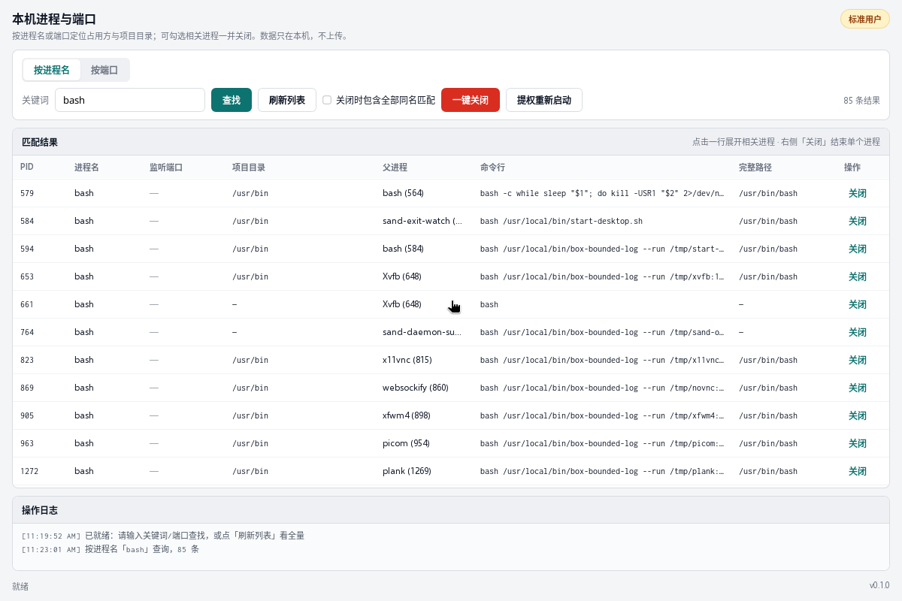
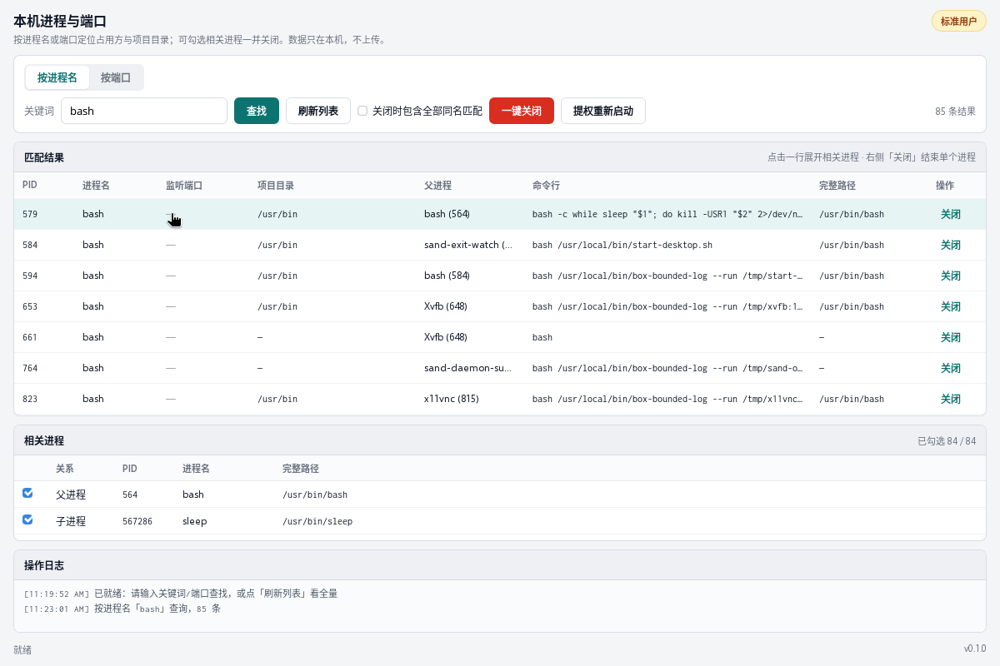
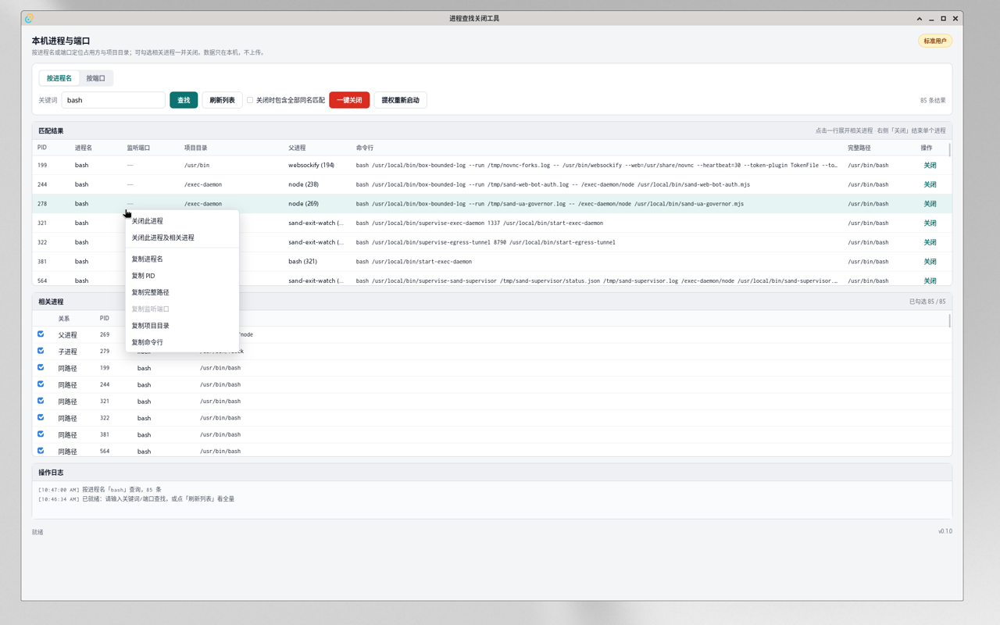
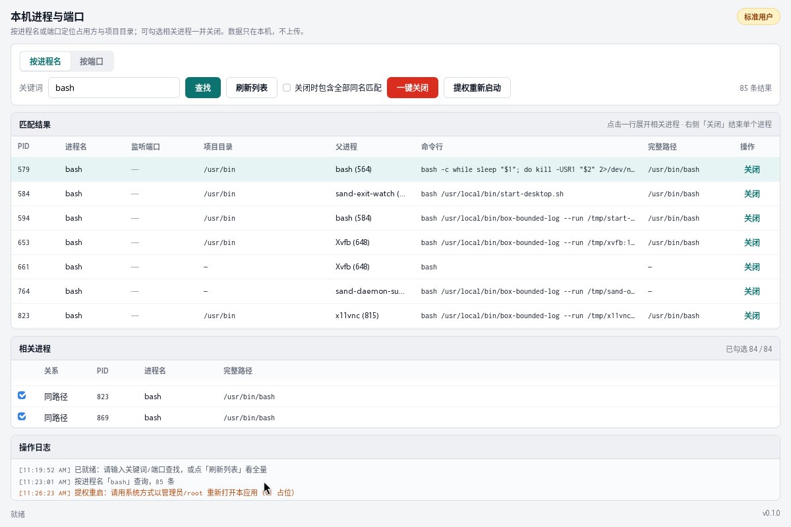
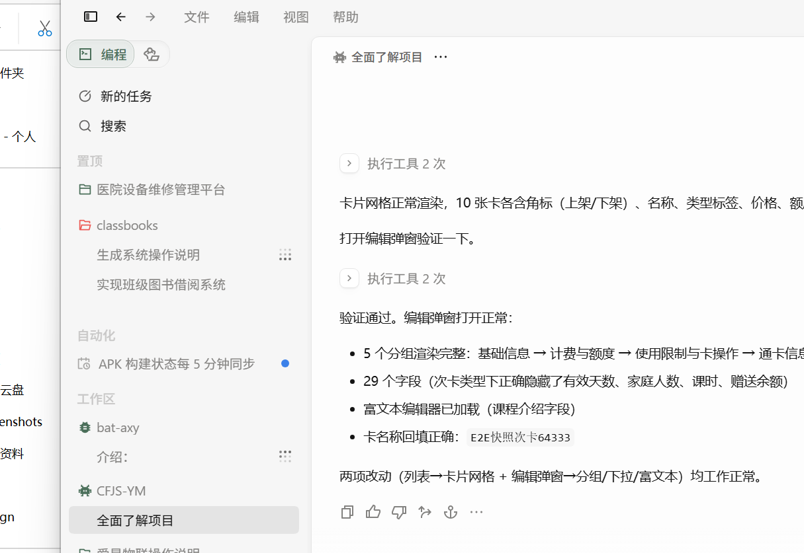

# 进程查找关闭工具 (process-manager)

Apple 以外平台的本机进程 / 端口查找与关闭工具：**Windows + Linux GUI（Tauri）**，以及 **Linux CLI（`procman`）**。共享 Rust 核心库 `procman-core`。

数据只在本机，不上传。

## 为什么用它

| 优势 | 说明 |
| --- | --- |
| **按需查找，启动不卡** | 打开不拉全量进程；按进程名或端口再搜，有明确 loading |
| **支持端口查询** | 👍限制Agent各种暂用端口，特别是node，通过这个可以快速查询哪些端口被哪些项目暂用了 |
| **项目目录可见** | 👍结果里直接看占用是否落在某个项目路径 |
| **相关进程一键清** | 点选一行展开父/子/同路径相关进程，可勾选连带关闭 |
| **右键快捷操作** | 关单个 / 关相关 / 复制 PID·路径·端口·命令行 |
| **一屏三区** | 匹配结果、相关进程、操作日志同屏，各区内滚，不整页乱滚 |
| **Win + Linux** | GUI 双端；Linux 另有 `procman` CLI |

## 界面预览

**启动不拉全量 — 先搜再看**



**按进程名 / 端口查找，带项目目录**



**相关进程展开，可勾选连带关闭**



**行内右键：关闭 / 关相关 / 复制字段**



**一屏布局：结果 + 相关 + 操作日志**



**桌面主界面（Win/Linux GUI 同源；示意含 Windows 路径）**



## 目录

- `crates/procman-core` — 进程列表、端口占用、项目目录推断、关闭与重启检测
- `crates/procman-cli` — Linux 命令行 `procman`
- `app` — Tauri 2 桌面 GUI（界面按 `docs/design/v2_*` + `SPEC.md`）
- `docs/` — PRD、设计稿、测试用例、README 截图
- `dist/` — 本机构建产物（一般不入仓）

## Linux CLI

```bash
cd /path/to/process-manager
cargo build -p procman-cli --release
./target/release/procman find --name node
./target/release/procman find --port 5173
./target/release/procman list
./target/release/procman related <pid>
./target/release/procman kill <pid> --yes
./target/release/procman kill --name node --yes
```

退出码：0 成功；1 一般错误；2 无匹配；3 权限不足；4 部分失败。

## GUI（Tauri）

依赖：Rust、Node、Linux 需 webkit2gtk 等（见 Tauri 官方 prerequisites）。

```bash
cd app
npm install
npm run tauri dev          # 开发（会起 Vite :1420）
npm run tauri build        # 发布：必须用这条，会内嵌前端
# 可双击/直接跑：
../target/release/process-manager
# 或 ../dist/process-manager-linux-amd64
```

不要用裸 `cargo build --release` 当 GUI 发布包：那不会按 Tauri 方式打包前端，容易出现连 `localhost:1420` 白屏。

Windows 包路径示例（本机构建后）：`D:\work\process-manager\dist\windows\`。

## 远程仓库

- Gitee：`https://gitee.com/hogan_dev/process-manager.git`

## 说明

- 数据只在本机，不上传
- 无模型文件；`.onnx` 等无关
